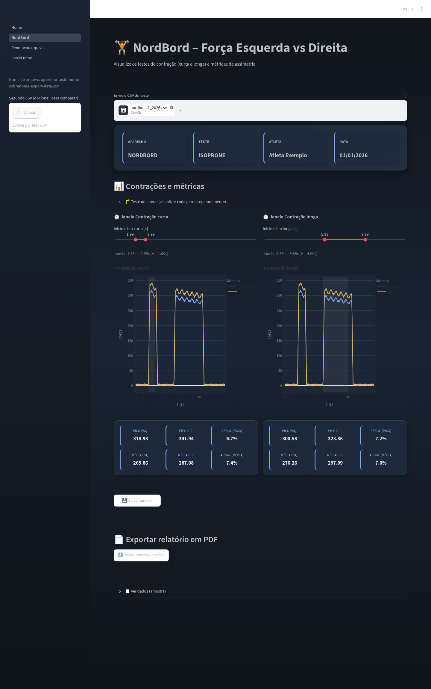
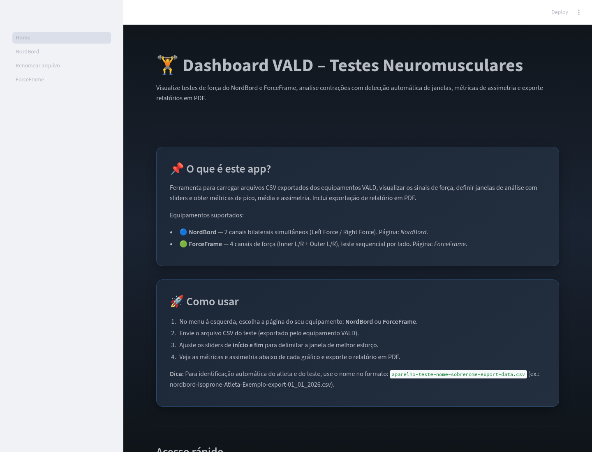
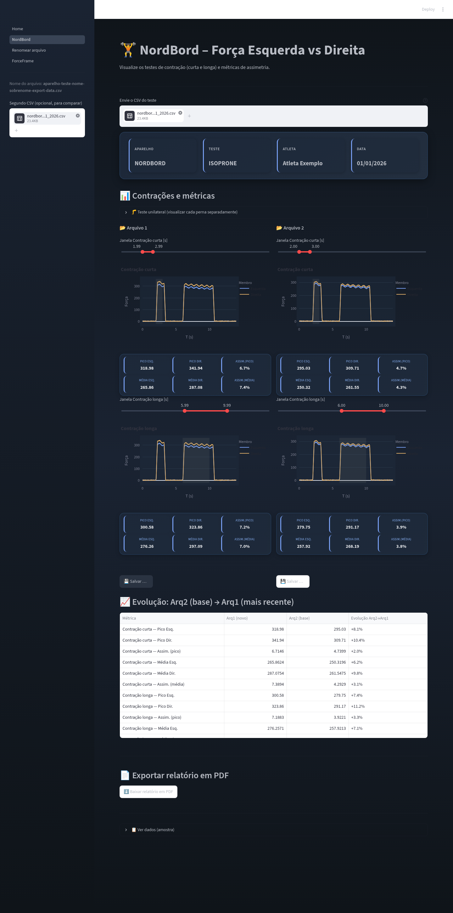
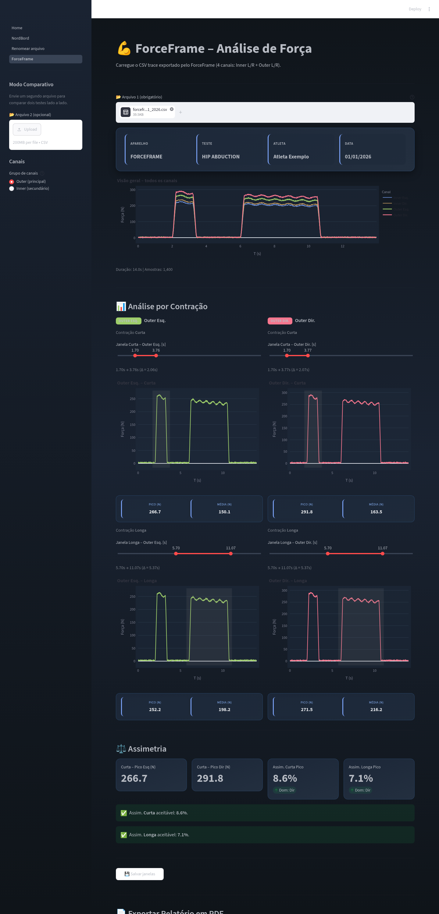
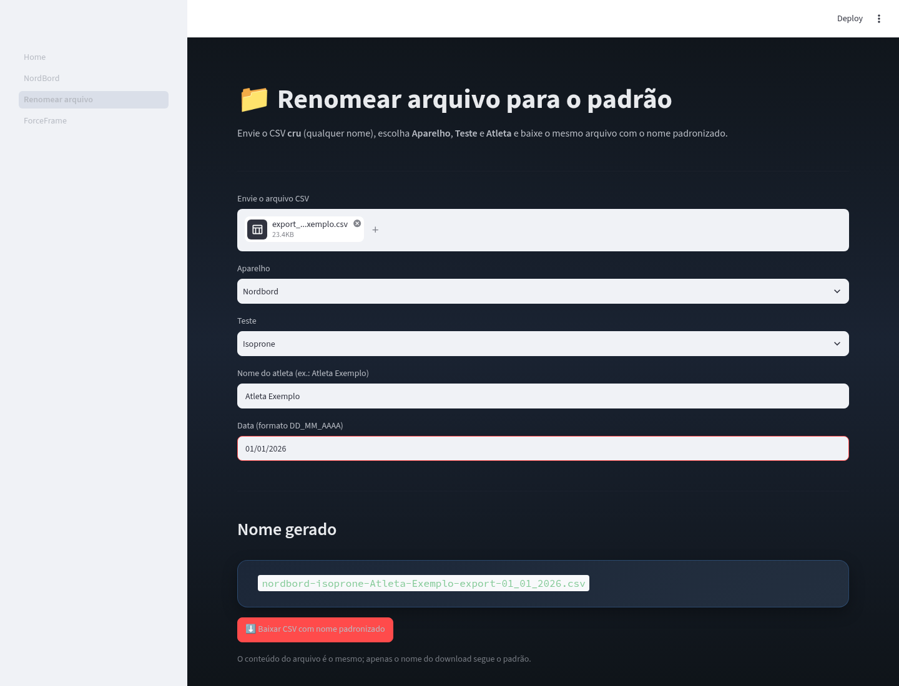
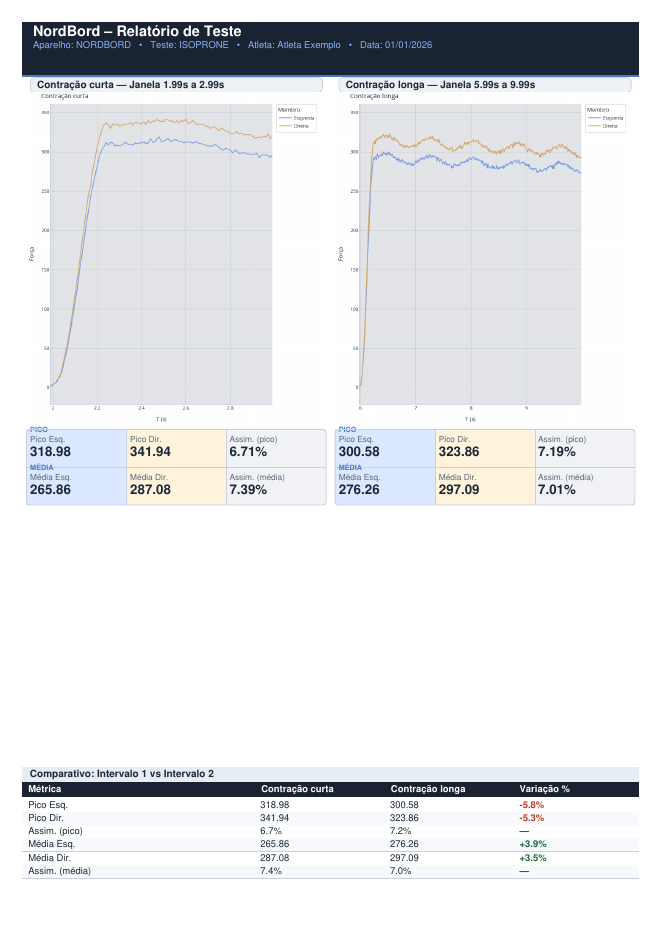
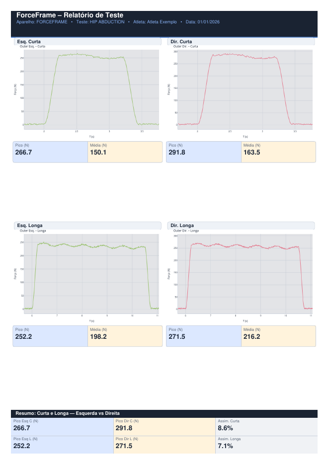

# Dashboard VALD — Testes Neuromusculares

Aplicação web local, desenvolvida em Python com Streamlit, para visualizar e analisar os arquivos de curva de força (*trace*) exportados dos equipamentos **NordBord** e **ForceFrame**, da VALD Performance. A aplicação delimita janelas de contração, calcula métricas de pico, média e assimetria entre os membros esquerdo e direito, compara duas avaliações e gera relatórios em PDF.

> Projeto independente, sem vínculo com a VALD Performance. Todos os nomes de atletas, datas e curvas mostrados neste documento e nas capturas de tela são fictícios (dados sintéticos). O repositório não contém dados de atletas.



---

## Sumário

1. [Contexto e objetivo](#1-contexto-e-objetivo)
2. [Equipamentos e origem dos dados](#2-equipamentos-e-origem-dos-dados)
3. [Formato dos arquivos de entrada](#3-formato-dos-arquivos-de-entrada)
4. [Padrão de nomenclatura dos arquivos](#4-padrão-de-nomenclatura-dos-arquivos)
5. [Funcionamento da aplicação](#5-funcionamento-da-aplicação)
6. [Métricas e cálculos](#6-métricas-e-cálculos)
7. [Relatórios em PDF](#7-relatórios-em-pdf)
8. [Persistência das janelas de análise](#8-persistência-das-janelas-de-análise)
9. [Tecnologias e dependências](#9-tecnologias-e-dependências)
10. [Instalação e execução local](#10-instalação-e-execução-local)
11. [Estrutura do repositório](#11-estrutura-do-repositório)
12. [Privacidade e dados](#12-privacidade-e-dados)
13. [Limitações conhecidas](#13-limitações-conhecidas)
14. [Capturas de tela](#14-capturas-de-tela)
15. [Autor e licença](#15-autor-e-licença)

---

## 1. Contexto e objetivo

Desenvolvi esta ferramenta para uso próprio no meu trabalho em fisiologia do esporte. O objetivo é padronizar a leitura dos arquivos de força exportados dos equipamentos VALD e agilizar três etapas da rotina de avaliação:

- seleção da janela de melhor esforço em cada contração;
- cálculo das métricas de força e de assimetria entre os membros;
- comparação entre duas avaliações do mesmo atleta e geração de um relatório em PDF.

## 2. Equipamentos e origem dos dados

A aplicação trabalha com o **NordBord e ForceFrame da VALD**. Cada equipamento tem uma página própria.

| Equipamento | Página | Canais lidos pela aplicação | Testes previstos no padrão de nome* |
|---|---|---|---|
| **NordBord** | `pages/2_NordBord.py` | 2 canais bilaterais simultâneos: `Left Force` e `Right Force` | `isoprone`, `nordic`, `iso_30`, `knee_extension`, `ankle_plantar_flexion`, `hip_flexion` |
| **ForceFrame** | `pages/4_ForceFrame.py` | 4 canais: `Inner Left`, `Inner Right`, `Outer Left` e `Outer Right` | `trace`, `isometric`, `hip_abduction`, `hip_adduction`, `knee_extension`, `knee_flexion`, `shoulder` |

\* Lista de testes da página **Renomear arquivo** (`pages/3_Renomear_arquivo.py`). O tipo de teste serve para identificação. O cálculo é o mesmo para todos os testes. A única diferença é o teste `nordic` do NordBord, cujas janelas passam a se chamar "1ª repetição" e "2ª repetição".

**Como os arquivos são gerados:** o teste é realizado no NordBord ou no ForceFrame. Em seguida, no **VALD Hub** (versão web ou aplicativo), abre-se a tela do teste e usa-se a opção de exportação da **curva de força bruta**, que gera o arquivo CSV usado pela aplicação. Os valores de força exportados estão em **newtons (N)** nos dois equipamentos.

## 3. Formato dos arquivos de entrada

- **Tipo:** CSV (`.csv`). Os campos de upload aceitam somente essa extensão. A aplicação não lê XLSX.
- **Separador:** detectado automaticamente (`sep=None` com o motor `python` do pandas). Vírgula e ponto e vírgula são aceitos, entre outros.
- **Codificação:** UTF-8. Na página ForceFrame, a leitura usa `utf-8-sig`, que tolera o BOM no início do arquivo.
- **Decimal:** valores com vírgula decimal (por exemplo, `123,45`) são convertidos para ponto antes da conversão numérica.
- **Linhas inválidas:** linhas sem valor de tempo são descartadas, e os dados são ordenados pelo tempo.

### 3.1 NordBord: colunas esperadas

| Coluna | Conteúdo | Alternativa se o nome não existir |
|---|---|---|
| `Seconds` | Tempo (s) | 1ª coluna do arquivo |
| `Left Force` | Força do membro esquerdo | 2ª coluna |
| `Right Force` | Força do membro direito | 3ª coluna |

Exemplo ilustrativo de estrutura (valores fictícios):

```csv
Seconds,Left Force,Right Force
0.00,1.2,0.8
0.01,1.5,1.1
0.02,2.0,1.7
```

Os valores de força estão em newtons (N). Os gráficos e cartões desta página exibem os números sem o rótulo de unidade. Se o arquivo tiver outras colunas, elas são ignoradas na análise e aparecem apenas na amostra de dados brutos.

### 3.2 ForceFrame: colunas esperadas

Os cabeçalhos são procurados por trecho de texto, sem diferenciar maiúsculas e minúsculas. Espaços, aspas e BOM são removidos antes da busca.

| Canal | Trecho procurado no cabeçalho | Alternativa se o nome não existir |
|---|---|---|
| Tempo | `second`, `time` ou `tempo` | 1ª coluna |
| Inner Esquerdo | `inner left` ou `inner_left` | 2ª coluna |
| Inner Direito | `inner right` ou `inner_right` | 3ª coluna |
| Outer Esquerdo | `outer left` ou `outer_left` | 4ª coluna |
| Outer Direito | `outer right` ou `outer_right` | 5ª coluna |

Exemplo ilustrativo de estrutura (valores fictícios):

```csv
Seconds,Inner Left,Inner Right,Outer Left,Outer Right
0.00,0.4,0.3,1.2,0.9
0.01,0.5,0.4,1.6,1.3
```

**Inner e Outer:** os canais correspondem às células de carga **interna (Inner)** e **externa (Outer)** do ForceFrame, com os rótulos usados na exportação do equipamento. A célula interna registra a força aplicada para dentro (adução), e a externa registra a força aplicada para fora (abdução). A aplicação analisa um grupo de cada vez, com um canal esquerdo e um direito. O grupo **Outer** é o padrão, descrito na interface como "canal de força principal". O grupo **Inner** pode ser selecionado na barra lateral. Cabe ao avaliador escolher o grupo que corresponde ao teste realizado. A visão geral mostra os quatro canais ao mesmo tempo. Os gráficos dessa página indicam a força em **N**.

## 4. Padrão de nomenclatura dos arquivos

Para que a aplicação identifique automaticamente o **aparelho**, o **teste**, o **atleta** e a **data**, o arquivo deve seguir este padrão:

```text
aparelho-teste-nome-sobrenome-export-DD_MM_AAAA.csv
```

Exemplos fictícios:

```text
nordbord-isoprone-Atleta-Exemplo-export-01_01_2026.csv
forceframe-trace-Atleta-Exemplo-export-01_01_2026.csv
```

Regras de leitura (função `parse_filename`):

- o nome é dividido pelo hífen `-`, e o arquivo precisa ter pelo menos 5 partes;
- a penúltima parte precisa ser `export`;
- a 1ª parte é o aparelho e a 2ª é o teste. Na exibição, ambos aparecem em maiúsculas, com `_` trocado por espaço;
- as partes entre o teste e `export` formam o nome do atleta;
- a última parte é a data, exibida como `DD/MM/AAAA`.

Um arquivo fora do padrão continua sendo analisado normalmente. Nesse caso, a aplicação exibe um aviso e não preenche aparelho, teste, atleta e data.

**Página "Renomear arquivo":** recebe o CSV com qualquer nome. O usuário escolhe o aparelho, o teste, o nome do atleta e a data, e a página devolve **o mesmo conteúdo** com o nome no padrão acima.

## 5. Funcionamento da aplicação

### 5.1 Fluxo geral

```text
CSV exportado (NordBord / ForceFrame)
        │
        ▼
[Renomear arquivo] (opcional: padroniza o nome)
        │
        ▼
Upload na página do equipamento
        │
        ▼
Leitura e limpeza (separador automático, vírgula decimal, ordenação por tempo)
        │
        ▼
Sugestão automática das janelas de contração
        │
        ▼
Ajuste manual das janelas (sliders de início e fim)
        │
        ▼
Métricas: pico, média e assimetria (e Δ entre dois arquivos)
        │
        ├──► Salvar janelas (saved_windows.json, local)
        └──► Relatório em PDF (download)
```

### 5.2 Página inicial (`Home.py`)

Apresenta a ferramenta, os equipamentos suportados, as instruções de uso, o padrão de nome dos arquivos e botões de acesso rápido às páginas NordBord e ForceFrame.

### 5.3 Página NordBord

1. Upload do CSV do teste e leitura das informações do nome do arquivo.
2. **Sugestão automática de janelas:** a aplicação sugere uma janela de **contração curta** e outra de **contração longa**. No teste `nordic`, elas se chamam 1ª e 2ª repetição.
3. **Modos de análise:**
   - **Bilateral, um arquivo:** curvas esquerda e direita sobrepostas, com duas janelas (curta e longa) e as métricas de cada uma.
   - **Comparativo, dois arquivos:** um segundo CSV pode ser enviado pela barra lateral. Cada arquivo tem janelas próprias, e uma tabela mostra a evolução de **Arq2 (base) para Arq1 (mais recente)**.
   - **Unilateral:** ativado em "Teste unilateral". Mostra a perna direita e a esquerda separadamente, com janelas independentes para cada uma. Nesse modo, o segundo arquivo não é usado.
4. Botões para salvar e apagar as janelas (ver seção 8).
5. Exportação do relatório em PDF.
6. Amostra dos dados brutos (primeiras 200 linhas).

### 5.4 Página ForceFrame

1. Upload do **Arquivo 1** (obrigatório). O **Arquivo 2** (opcional) é enviado pela barra lateral e ativa o modo comparativo.
2. Escolha do grupo de canais: **Outer** (padrão) ou **Inner**.
3. **Visão geral:** gráfico com todos os canais detectados, duração do teste e número de amostras.
4. **Modo simples (um arquivo):** quatro janelas, **Esquerda Curta**, **Esquerda Longa**, **Direita Curta** e **Direita Longa**, cada uma com gráfico, pico (N) e média (N). Em seguida, um bloco de **assimetria** classifica o resultado como aceitável, moderado ou elevado (ver seção 6).
5. **Modo comparativo (dois arquivos):** seções **Esquerda** e **Direita**, com Arq1 e Arq2 lado a lado e tabelas de **Δ Pico** e **Δ Média** para as contrações curta e longa.
6. Botões para salvar e apagar as janelas, exportação em PDF e amostra dos dados brutos.

## 6. Métricas e cálculos

### 6.1 Sugestão automática de janelas

| Etapa | NordBord | ForceFrame |
|---|---|---|
| Sinal usado | Maior valor entre esquerda e direita a cada instante | Valor absoluto do canal (esquerdo e direito sugeridos separadamente) |
| Suavização | Média móvel de cerca de 0,1 s (mínimo de 5 amostras) | Igual |
| Linha de base | Primeiros 0,5 s do registro | Igual |
| Limiar de atividade | média da linha de base + 5 × desvio-padrão | o maior valor entre (média + 5 × desvio-padrão) e 5,0 |
| Duração mínima de um segmento | 0,3 s | 0,2 s |
| Janela curta | Início do **primeiro** segmento até **+1,0 s** | **Penúltimo** segmento, com margem de 0,3 s |
| Janela longa | Início do **último** segmento até **+4,0 s** | **Último** segmento, com margem de 0,3 s |
| Sem atividade detectada | 0–1 s e 0–4 s | Registro inteiro |

As janelas sugeridas são apenas um ponto de partida. O avaliador ajusta o início e o fim de cada janela pelos sliders, com passo de 0,01 s no NordBord e 0,05 s no ForceFrame.

### 6.2 Métricas por janela

- **Pico:** valor máximo da força dentro da janela.
- **Média:** média da força dentro da janela.

### 6.3 Assimetria

```text
Assimetria (%) = 100 × (Direita − Esquerda) / max(|Esquerda|, |Direita|)
```

- Valor **positivo** indica predominância da **direita**, e valor **negativo** indica predominância da **esquerda**.
- **NordBord:** calculada para o pico e para a média de cada janela. No PDF, valores com |assimetria| > 10% são destacados em vermelho.
- **ForceFrame:** calculada para o pico e para a média. A interface mostra a assimetria de pico com indicação do lado dominante e a classifica assim:
  - |assimetria| ≤ 10%: **aceitável**;
  - 10% < |assimetria| ≤ 15%: **moderada**, recomenda-se monitorar;
  - |assimetria| > 15%: **elevada**.

Os limiares de 10% e 15% são um **critério interno do departamento de fisiologia** em que a ferramenta é usada. Eles não são uma norma do fabricante nem uma referência da literatura.

### 6.4 Comparação entre dois arquivos

O **Arq1** é sempre tratado como a avaliação **mais recente** e o **Arq2** como a **base**.

```text
Δ força (%) = (Arq1 − Arq2) / |Arq2| × 100      → positivo = aumento de força (verde)
Δ assimetria = |assim. Arq1| − |assim. Arq2|    → negativo = assimetria menor (verde)
```

No PDF do NordBord com um único arquivo, a tabela "Intervalo 1 vs Intervalo 2" mostra a variação percentual entre as duas janelas, calculada sobre o intervalo 1, para as métricas de força.

## 7. Relatórios em PDF

Os relatórios são gerados em formato **A4** com ReportLab. Os gráficos são convertidos em imagem com Plotly e Kaleido. Se o ReportLab ou o Kaleido não estiverem instalados, a aplicação exibe um aviso no lugar do botão de download.

| Página / modo | Conteúdo do PDF | Nome do arquivo gerado |
|---|---|---|
| NordBord, um arquivo (bilateral) | 1 página: cabeçalho (aparelho, teste, atleta, data), 2 gráficos recortados nas janelas, métricas e tabela "Comparativo: Intervalo 1 vs Intervalo 2" | `<nome-do-csv>_relatorio.pdf` |
| NordBord, unilateral | 4 gráficos (Direita e Esquerda, curta e longa) com pico e média | `<nome-do-csv>_relatorio.pdf` |
| NordBord, dois arquivos | Página 1: 4 gráficos identificados como Arq1/Arq2. Página 2: tabela de evolução Arq2 → Arq1 | `<nome-do-csv>_relatorio.pdf` |
| ForceFrame, um arquivo | 1 página: 4 gráficos (Esq./Dir., curta e longa) e resumo de picos e assimetrias | `<nome-do-csv>_relatorio.pdf` |
| ForceFrame, dois arquivos | 3 páginas: comparativo Esquerda, comparativo Direita e resumo comparativo com Δ | `comparativo_<arq1>_vs_<arq2>.pdf` |

## 8. Persistência das janelas de análise

O módulo `windows_store.py` grava as posições dos sliders no arquivo `saved_windows.json`, na raiz do projeto. A chave é o **nome do arquivo CSV**, e cada registro guarda a data e a hora em que foi salvo. Quando o mesmo arquivo é carregado novamente, as janelas são restauradas automaticamente. O registro pode ser apagado pelo botão "Apagar".

- NordBord: guarda as janelas curta e longa.
- ForceFrame: guarda as quatro janelas (Esq. e Dir., curta e longa).

O arquivo `saved_windows.json` é local e está no `.gitignore`.

## 9. Tecnologias e dependências

| Tecnologia | Uso no projeto | Versão (`requirements.txt`) |
|---|---|---|
| Python | Linguagem | 3.10 ou superior (ver seção 13) |
| Streamlit | Interface web com múltiplas páginas | `>=1.30.0` |
| pandas | Leitura do CSV e tratamento dos dados | `>=2.0.0` |
| NumPy | Cálculos numéricos | `>=1.24.0` |
| Plotly | Gráficos interativos | `>=5.18.0` |
| Kaleido | Exportação dos gráficos como imagem para o PDF | `==0.2.1` (requer Plotly < 7, ver seção 13) |
| ReportLab | Geração do PDF | `>=4.0.0` |

O repositório inclui um `.devcontainer/devcontainer.json` (imagem Python 3.11) para execução em GitHub Codespaces ou VS Code Dev Containers. Esse ambiente instala as dependências e inicia o Streamlit na porta 8501.

## 10. Instalação e execução local

Pré-requisitos: Python 3.10 ou superior e Git.

```bash
git clone https://github.com/takeichijulio/vald-dashboard.git
cd vald-dashboard

python -m venv .venv
# Windows:
.venv\Scripts\activate
# Linux/macOS:
source .venv/bin/activate

pip install -r requirements.txt
streamlit run Home.py
```

A aplicação abre em `http://localhost:8501`. A navegação entre **Home**, **NordBord**, **Renomear arquivo** e **ForceFrame** é feita pelo menu lateral.

**Uso rápido:**

1. (Opcional) Na página **Renomear arquivo**, padronize o nome do CSV.
2. Abra a página do equipamento e envie o CSV.
3. Ajuste as janelas de início e fim de cada contração.
4. Confira as métricas e a assimetria. Se quiser comparar avaliações, envie um segundo arquivo pela barra lateral.
5. Salve as janelas, se for o caso, e baixe o relatório em PDF.

## 11. Estrutura do repositório

```text
vald-dashboard/
├── .devcontainer/
│   └── devcontainer.json      # Ambiente para Codespaces/Dev Containers (Python 3.11, porta 8501)
├── docs/
│   └── screenshots/           # Capturas de tela geradas com dados fictícios
├── pages/
│   ├── 2_NordBord.py          # Análise NordBord: bilateral, unilateral, comparativo e PDF
│   ├── 3_Renomear_arquivo.py  # Padroniza o nome do CSV (aparelho, teste, atleta, data)
│   └── 4_ForceFrame.py        # Análise ForceFrame: 4 canais, simples, comparativo e PDF
├── .gitignore                 # Ignora ambientes, saved_windows.json, *.csv e *.xlsx
├── Home.py                    # Página inicial e instruções de uso
├── LICENSE                    # Licença MIT
├── README.md
├── requirements.txt           # Dependências Python
└── windows_store.py           # Salva, carrega e apaga janelas de análise (saved_windows.json)
```

## 12. Privacidade e dados

- O processamento é **local**. Os arquivos enviados são lidos em memória pela sessão do Streamlit, e o código da aplicação não faz chamadas de rede nem envia dados para serviços externos.
- O `.gitignore` impede o versionamento de `*.csv`, `*.xlsx` e `saved_windows.json`.
- Nunca adicione ao repositório arquivos de avaliações reais, relatórios PDF ou capturas de tela com dados de atletas. Para demonstrações, use arquivos sintéticos com nomes fictícios (por exemplo, `Atleta-Exemplo`, `01_01_2026`).

## 13. Limitações conhecidas

- **Versão do Python:** o código usa anotações de tipo como `dict | None` (`windows_store.py` e `pages/4_ForceFrame.py`), que exigem **Python 3.10 ou superior**.
- **Plotly e Kaleido 0.2.1:** a exportação de gráficos para o PDF usa o parâmetro `engine="kaleido"`, que o Plotly 7 não aceita. Por isso, o `requirements.txt` limita o Plotly a versões anteriores à 7 (`plotly>=5.18.0,<7`). Com Plotly 5.24 ou 6.3, os gráficos aparecem normalmente no PDF (verificado). Se uma versão incompatível for instalada, o PDF continua sendo gerado, mas os gráficos são substituídos pelo aviso "exportação indisponível neste ambiente".
- **Somente CSV:** XLSX e outros formatos não são aceitos.
- **Colunas por posição:** se os cabeçalhos esperados não forem encontrados, a aplicação assume a ordem das colunas (tempo, esquerda, direita…). Um arquivo com outra ordem gera resultados incorretos sem nenhum aviso.
- **Identificação pelo nome:** atleta, teste e data vêm apenas do nome do arquivo, não do conteúdo do CSV.
- **Janelas salvas por nome de arquivo:** dois arquivos diferentes com o mesmo nome compartilham o mesmo registro em `saved_windows.json`.
- **Persistência local:** em ambientes efêmeros (por exemplo, Codespaces ou hospedagem em nuvem), `saved_windows.json` pode ser perdido.
- **Página Renomear:** o campo de data traz o rótulo "DD_MM_AAAA", mas espera a digitação no formato `DD/MM/AAAA`. Uma data inválida é substituída pela data atual.
- **Avisos de depreciação:** versões recentes do Streamlit exibem avisos sobre o parâmetro `use_container_width`, que ainda funciona.
- **Uso pretendido:** ferramenta de apoio à análise. As métricas e os limiares não substituem a interpretação profissional nem o software oficial do fabricante.

## 14. Capturas de tela

Todas as imagens abaixo foram geradas a partir da aplicação em execução local, com **dados 100% fictícios**: curvas sintéticas, atleta "Atleta Exemplo" e datas fictícias.

| Tela | Imagem |
|---|---|
| Página inicial |  |
| NordBord, bilateral (um arquivo) |  |
| NordBord, comparativo (dois arquivos) |  |
| ForceFrame, modo simples (grupo Outer) |  |
| Renomear arquivo |  |
| Relatório PDF, NordBord |  |
| Relatório PDF, ForceFrame |  |

## 15. Autor e licença

**Júlio Murashima**: [LinkedIn](https://www.linkedin.com/in/julio-murashima)

Distribuído sob a licença **MIT**. Consulte o arquivo [`LICENSE`](LICENSE).
